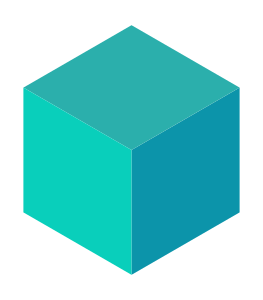
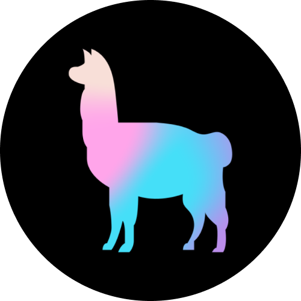
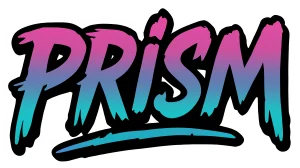

<h1 align="center">Hi, I'm Rama Raihan</h1>

  Full-stack developer from Salatiga, Indonesia. 
  I build web apps end to end in Laravel and Next.js, with Postgres or MySQL underneath. 
  I also build LLM apps: RAG, agents and the tools around them.

  
  

---

## What I work with

### Frontend

| &nbsp;&nbsp;&nbsp;&nbsp;&nbsp;&nbsp;&nbsp;&nbsp;&nbsp;&nbsp; | Name | Where I use it |
|:----:|:-----|:------------------|
|  | **Next.js** | Most of my apps run on it. App Router, server components, the usual setup. My offline-first till, warung-pos, is a Next.js 16 PWA. |
|  | **React** | Building the interface. Components, hooks, client state. Also the frontend of antre, through Inertia. |
|  | **TypeScript** | All my frontend and Node code is TypeScript now. Catches my mistakes before they reach the browser. |
|  | **Tailwind CSS** | Styling. Quicker for me than keeping a separate stylesheet in sync. |
|  | **Vite** | Bundles the frontend assets on my Laravel projects. |
|  | **Inertia.js** | Connects Laravel to a React frontend in antre, so I get React pages without building a separate API. |
|  | **htmx** | Small interactions on the server-rendered pages of webhook-inbox, where a full frontend would be too much. |

### Backend

| &nbsp;&nbsp;&nbsp;&nbsp;&nbsp;&nbsp;&nbsp;&nbsp;&nbsp;&nbsp; | Name | Where I use it |
|:----:|:-----|:------------------|
|  | **Laravel** | APIs, Eloquent, queues, auth. Blade when a page is better rendered on the server. |
|  | **Laravel Reverb** | Websockets for antre. Ticket calls reach the staff console and the waiting room TV without polling. |
|  | **PHP** | The language behind all the Laravel work. |
|  | **Node.js** | Runs the server side of Next.js, route handlers and server actions. |
|  | **Python** | Backend for my AI projects, managed with uv. |
|  | **Rust** | webhook-inbox: receives webhooks, checks signatures and forwards them with retries. axum, tokio and sqlx. |
|  | **Go** | pg-backup: streams a Postgres dump to S3-compatible storage and restores it to check it works. |

### Database

| &nbsp;&nbsp;&nbsp;&nbsp;&nbsp;&nbsp;&nbsp;&nbsp;&nbsp;&nbsp; | Name | Where I use it |
|:----:|:-----|:------------------|
|  | **PostgreSQL** | My default. Relational data, migrations, a bit of PL/pgSQL when a query gets hairy. Row locks with SKIP LOCKED for queues in antre and webhook-inbox. |
|  | **MySQL** | What most of my Laravel projects sit on, especially the ones on shared hosting. |
|  | **MongoDB** | Used on an LMS, where the shape of the content kept changing on me. |
|  | **Drizzle ORM** | Typed queries and migrations on Postgres in warung-pos. |

### Testing

| &nbsp;&nbsp;&nbsp;&nbsp;&nbsp;&nbsp;&nbsp;&nbsp;&nbsp;&nbsp;&nbsp;&nbsp;&nbsp;&nbsp; | Name | Where I use it |
|:----:|:-----|:------------------|
|   | **Pest / PHPUnit** | Tests on the Laravel side, feature tests more than unit tests. antre's tests run on Pest; PHPUnit is what it sits on. |
|  | **Vitest** | Unit and integration tests in my TypeScript projects, including warung-pos. |
|  | **pytest** | Tests in my Python projects. |
|  | **Playwright** | Browser tests. In warung-pos they switch the network off and check that offline sales sync later. In antre they run against a live websocket server. |
|  | **Testcontainers** | pg-backup tests start a real Postgres 17 and MinIO in Docker instead of mocking them. |

### Deployment and ops

| &nbsp;&nbsp;&nbsp;&nbsp;&nbsp;&nbsp;&nbsp;&nbsp;&nbsp;&nbsp; | Name | Where I use it |
|:----:|:-----|:------------------|
|  | **Docker** | So the app behaves the same on my laptop as it does on the server. |
|  | **GitHub Actions** | Runs lint and tests on every push, and deploys my portfolio to GitHub Pages. |
|  | **Coolify** | Deploys my Laravel and Next.js apps to my own VPS instead of renting a platform. |
|  | **Git** | Version control, one branch per feature. |
|  | **MinIO / S3** | Where pg-backup stores its backups. I run MinIO locally; it speaks the same S3 API as AWS. |
|  | **Prometheus** | Metrics endpoints on webhook-inbox and pg-backup, so I can see deliveries and backups from outside. |

### Payments

| &nbsp;&nbsp;&nbsp;&nbsp;&nbsp;&nbsp;&nbsp;&nbsp;&nbsp;&nbsp;&nbsp;&nbsp;&nbsp;&nbsp;&nbsp;&nbsp;&nbsp;&nbsp;&nbsp;&nbsp;&nbsp;&nbsp;&nbsp;&nbsp; | Name | Where I use it |
|:----:|:-----|:------------------|
|  | **Midtrans** | Checkout and payment handling for the Indonesian projects. webhook-inbox checks its callback signatures. |

### AI

| &nbsp;&nbsp;&nbsp;&nbsp;&nbsp;&nbsp;&nbsp;&nbsp;&nbsp;&nbsp;&nbsp;&nbsp;&nbsp;&nbsp;&nbsp;&nbsp;&nbsp;&nbsp;&nbsp;&nbsp; | Name | Where I use it |
|:----:|:-----|:------------------|
|  | **FastAPI** | Serves my docs assistant and research agent, with answers streamed over server-sent events. |
|  | **LangChain / LangGraph** | LangGraph runs my research agent: a plan, a human review step, then parallel searches. LangChain handles the model calls in text-to-sql-chat. |
|  | **LlamaIndex** | Document ingestion and pgvector search in my docs question-answering app. |
|  | **Vercel AI SDK** | Streaming chat and tool calls in a Next.js support bot. |
|  | **Prism PHP** | Reads supplier invoices into typed data inside a Laravel app. |
|  | **Ollama and llama.cpp** | Local models. My apps default to Ollama so they cost nothing to run, and I code with llama.cpp on my laptop. |
|    | **OpenAI, Gemini and Claude APIs** | One setting switches providers in each AI app, and my llm-gateway puts all of them behind one endpoint. |
|  | **pgvector** | Vector search inside Postgres, so there is no separate vector database to run. |
|  | **MCP** | Exposes the guarded SQL tools of text-to-sql-chat to Claude Desktop and Cursor. |

---

## Things I've built lately

Full-stack apps

- [antre](https://github.com/ramaraihan12/antre): queue and booking system for small clinics and barbershops. Customers take a ticket or book a slot, staff call numbers, and a TV in the waiting room shows and announces them live. Laravel, Inertia, React, Reverb, Postgres.
- [warung-pos](https://github.com/ramaraihan12/warung-pos): a point of sale for a small shop that keeps selling when the internet drops and syncs when it comes back. Next.js, Drizzle, Dexie, a service worker.
- [ralaex](https://github.com/ramaraihan12/ralaex): a household finance app my wife and I use. Next.js, Supabase.

Backend and tools

- [webhook-inbox](https://github.com/ramaraihan12/webhook-inbox): receives webhooks from Midtrans, Xendit or GitHub, checks the signature, stores each one and forwards it with retries. Rust, axum, Postgres.
- [pg-backup](https://github.com/ramaraihan12/pg-backup): streams a Postgres dump to S3 or MinIO, compressed and encrypted, and proves each backup by restoring it. Go.
- [llm-gateway](https://github.com/ramaraihan12/llm-gateway): one OpenAI-compatible endpoint in front of OpenAI, Gemini, Claude and Ollama, with fallback, rate limits and cost logs. TypeScript, Hono.
- [issue-triage-action](https://github.com/ramaraihan12/issue-triage-action): a GitHub Action that labels new issues, points out likely duplicates and asks for missing details. TypeScript.
- [local-ai-coding-setup](https://github.com/ramaraihan12/local-ai-coding-setup): the free local coding setup I run on a 6 GB laptop GPU, with scripts and benchmarks. llama.cpp, Ollama.

AI apps

- [docs-rag-assistant](https://github.com/ramaraihan12/docs-rag-assistant): ask questions about your PDF, DOCX and Markdown files and get answers that cite the page. FastAPI, LlamaIndex, pgvector.
- [research-agent](https://github.com/ramaraihan12/research-agent): plans a question, waits for me to approve the plan, searches the web and writes a cited report. LangGraph, FastAPI.
- [shop-support-bot](https://github.com/ramaraihan12/shop-support-bot): support chatbot for a small shop that checks orders and stock, opens tickets and hands over to a human. Next.js, Vercel AI SDK, pgvector.
- [invoice-flow](https://github.com/ramaraihan12/invoice-flow): reads supplier invoices with an LLM, flags what looks wrong and exports approved ones to CSV and a signed webhook. Laravel, Prism PHP.
- [text-to-sql-chat](https://github.com/ramaraihan12/text-to-sql-chat): ask a sales database questions in English or Indonesian, with the SQL checked before it runs. Python, LangChain, Streamlit, MCP.

---

## My contribution graph

Pac-Man is working through my commits.

<!-- pacman -->
<picture>
  <source media="(prefers-color-scheme: dark)" srcset="https://raw.githubusercontent.com/ramaraihan12/ramaraihan12/output/pacman-contribution-graph-dark.svg" />
  <source media="(prefers-color-scheme: light)" srcset="https://raw.githubusercontent.com/ramaraihan12/ramaraihan12/output/pacman-contribution-graph.svg" />
  
</picture>

---

  Want to talk? <a href="mailto:ramaraihan97@gmail.com">ramaraihan97@gmail.com</a>

